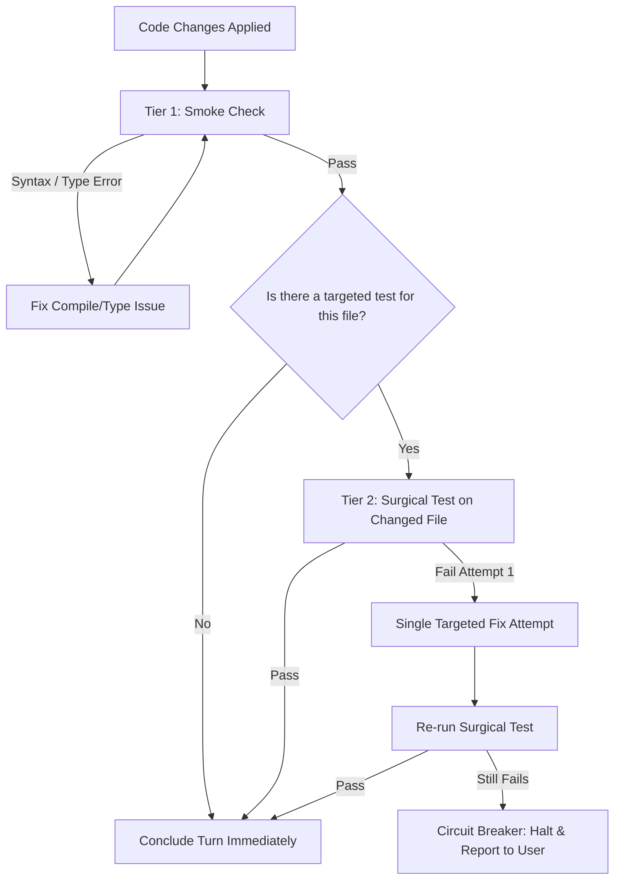

# FasterAgent Skill ⚡

High-velocity execution and lean verification engine for Antigravity AI agents.

## When to Activate
- When the user invokes `/faster-agent` or asks for fast, direct, high-performance task execution.
- When an agent is spending too much time running tests, exploring irrelevant files, or writing long monologues.
- When working on fast-paced development where complete code delivery and rapid surgical verification are paramount.

---

## Core Execution Protocol

### Step 1: Zero-Hesitation Implementation (Turn 1 Execution)
- Do NOT spend turns describing what you plan to do in the future.
- Formulate the precise solution in your reasoning process and execute the file edits immediately.
- Guarantee 100% implementation:
  - Every function, method, interface, and handler must be fully written.
  - Zero placeholder comments (`// TODO`, `# pass`, `/* ... */`).

### Step 2: Tiered Lean Verification Protocol



#### Tier 1: Smoke Check (Targeted File Only)
Verify that the code compiles, parses, or passes strict type checks without errors.
- **Node / TypeScript**:
  ```bash
  npx tsc --noEmit
  # or single file lint
  npx eslint <path_to_file>
  ```
- **Python**:
  ```bash
  python -m py_compile <path_to_file>
  ```
- **PHP**:
  ```bash
  php -l <path_to_file>
  ```
- **Go / Rust**:
  ```bash
  go vet ./<package>
  # or
  cargo check
  ```

#### Tier 2: Surgical Test (Targeted Spec Only)
Identify the single test file corresponding to the modified code:
- **Jest / Vitest / Mocha**:
  ```bash
  npx vitest run path/to/spec.test.ts
  ```
- **Pytest**:
  ```bash
  pytest tests/test_target.py -k test_exact_case
  ```
- **Pest / PHPUnit**:
  ```bash
  ./vendor/bin/pest tests/Feature/TargetTest.php
  ```

#### Tier 3: Strict Circuit Breaker (Anti-Looping Rule)
- **Early Exit**: As soon as the surgical test passes, **STOP ALL TESTING IMMEDIATELY**.
- **Forbidden Action**: NEVER run `npm test`, `pytest`, `cargo test`, or `composer test` on the whole project unless the user specifically typed "run all tests" or "run full test suite".
- **Retry Limit**: If the surgical test fails, attempt at most **ONE (1)** fix. If it fails a second time, immediately stop and present the failure message and your diagnostic analysis to the user.

---

## Output Format
Always maintain high communication density:
1. **Summary of Action**: 1 short bullet point on what changed.
2. **Changed Files & Diffs**: Exact files and key modifications.
3. **Verification Status**:
   - Smoke check result (Pass/N/A)
   - Surgical test result (Pass/Fail with output summary)
